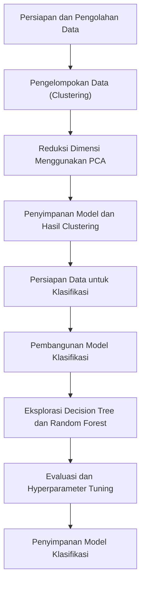

# Submission Akhir BMLP: Clustering dan Klasifikasi

| Nama | Peran |
|---|---|
| Yanaka Sofia Pardede | Machine Learning & Data Analysis |

## Gambaran Umum Proyek

Proyek ini merupakan **Submission Akhir BMLP (Belajar Machine Learning Pemula)** dalam program pelatihan **Asah Dicoding**. Proyek ini berfokus pada penerapan dua pendekatan utama dalam pembelajaran mesin (*Machine Learning*), yaitu **Clustering** dan **Klasifikasi**.

Tahap Clustering bertujuan untuk melakukan pengelompokan data berdasarkan karakteristik tertentu melalui penerapan algoritma pengelompokan dan reduksi dimensi menggunakan *Principal Component Analysis* (PCA).

Selanjutnya, tahap Klasifikasi berfokus pada pembangunan dan eksplorasi model klasifikasi, termasuk penggunaan algoritma Decision Tree dan Random Forest serta proses *hyperparameter tuning* untuk memperoleh model dengan performa yang lebih baik.

Seluruh tahapan eksperimen didokumentasikan dalam Jupyter Notebook. Selain itu, proyek ini menyertakan hasil pengolahan data dalam format CSV serta penyimpanan artefak model dalam format HDF5 (`.h5`) untuk mendukung dokumentasi dan penggunaan kembali model.

### Tujuan Proyek

1. Melakukan eksplorasi dan pengolahan data sebagai persiapan proses pembelajaran mesin.
2. Menerapkan metode Clustering untuk mengelompokkan data berdasarkan karakteristik yang dimiliki.
3. Menggunakan PCA untuk melakukan reduksi dimensi pada proses pengelompokan data.
4. Menyimpan model Clustering dan dataset hasil pengelompokan agar dapat digunakan kembali.
5. Membangun dan mengevaluasi model klasifikasi menggunakan algoritma Decision Tree dan Random Forest.
6. Melakukan *hyperparameter tuning* untuk mengeksplorasi dan meningkatkan performa model klasifikasi.
7. Menyimpan artefak model sebagai hasil akhir dari proses eksperimen.

## Dataset dan Berkas Proyek

Proyek ini terdiri atas dua notebook utama serta beberapa berkas hasil pengolahan data dan penyimpanan model.

### 1. Notebook Clustering

- **`[Clustering]_Submission_Akhir_BMLP_Yan...ipynb`**: Notebook yang berisi tahapan eksplorasi data, pengolahan data, reduksi dimensi menggunakan PCA, proses Clustering, serta penyimpanan hasil pengelompokan.

### 2. Notebook Klasifikasi

- **`[Klasifikasi]_Submission_Akhir_BMLP_Yan...ipynb`**: Notebook yang berisi tahapan pembangunan model klasifikasi, eksplorasi algoritma Decision Tree dan Random Forest, evaluasi model, serta *hyperparameter tuning*.

### 3. Berkas Hasil Pengolahan Data

| Nama Berkas | Keterangan |
|---|---|
| `data_clustering.csv` | Dataset hasil proses pengelompokan (Clustering). |
| `data_clustering_inverse.csv` | Dataset hasil pengelompokan yang telah dikembalikan ke representasi atau skala sebelumnya melalui proses *inverse transform*. |

### 4. Berkas Model

| Nama Berkas | Keterangan |
|---|---|
| `PCA_model_clustering.h5` | Artefak model PCA pada tahap Clustering. |
| `model_clustering.h5` | Artefak model Clustering. |
| `decision_tree_model.h5` | Artefak model Decision Tree untuk klasifikasi. |
| `explore_random_forest_classification.h5` | Artefak model hasil eksplorasi Random Forest. |
| `tuning_classification.h5` | Artefak model klasifikasi hasil proses *hyperparameter tuning*. |

## Alur Pengerjaan

Proyek ini dibagi menjadi dua tahapan utama, yaitu pengelompokan data (Clustering) dan klasifikasi (Klasifikasi).



### 1. Tahap Pengelompokan Data (Clustering)

Tahap ini berfokus pada proses eksplorasi dan pengelompokan data. PCA diterapkan sebagai metode reduksi dimensi untuk membantu merepresentasikan data dalam dimensi yang lebih rendah.

Hasil pengelompokan kemudian disimpan dalam bentuk dataset CSV dan artefak model agar dapat digunakan pada tahapan selanjutnya.

### 2. Tahap Klasifikasi

Tahap klasifikasi dilakukan untuk membangun model pembelajaran mesin yang mampu memprediksi kelas berdasarkan karakteristik data.

Beberapa aktivitas yang dilakukan meliputi:

- Pembangunan model klasifikasi menggunakan Decision Tree.
- Eksplorasi model klasifikasi menggunakan Random Forest.
- Evaluasi performa model.
- Penerapan *hyperparameter tuning* untuk mengeksplorasi konfigurasi model yang lebih optimal.
- Penyimpanan artefak model hasil eksperimen.

## Ringkasan Pemodelan dan Hasil

| Tahapan | Berkas Terkait | Keterangan |
|---|---|---|
| Reduksi Dimensi dan Clustering | `PCA_model_clustering.h5`, `model_clustering.h5` | Penerapan PCA dan pengelompokan data. |
| Penyimpanan Hasil Clustering | `data_clustering.csv`, `data_clustering_inverse.csv` | Penyimpanan dataset hasil pengelompokan dan hasil *inverse transform*. |
| Eksplorasi Model Klasifikasi | `decision_tree_model.h5`, `explore_random_forest_classification.h5` | Eksperimen menggunakan Decision Tree dan Random Forest. |
| Optimasi Model Klasifikasi | `tuning_classification.h5` | Penyimpanan model hasil proses *hyperparameter tuning*. |

## Poin Utama Proyek

Beberapa poin utama dari implementasi proyek ini meliputi:

- Pembagian proses pembelajaran mesin ke dalam dua tahapan utama, yaitu Clustering dan Klasifikasi, yang masing-masing didokumentasikan dalam notebook terpisah.
- Penerapan PCA sebagai metode reduksi dimensi pada tahap Clustering.
- Penyimpanan hasil pengelompokan data dalam format CSV, termasuk hasil *inverse transform*.
- Eksplorasi algoritma Decision Tree dan Random Forest pada tahap Klasifikasi.
- Penerapan *hyperparameter tuning* sebagai bagian dari proses pengembangan model klasifikasi.
- Penyimpanan berbagai artefak model dalam format `.h5` untuk mendokumentasikan hasil eksperimen.

## Keterbatasan

- **Dokumentasi Metrik Evaluasi:** Nilai metrik evaluasi dan konfigurasi model perlu dilengkapi berdasarkan hasil eksperimen pada masing-masing notebook.
- **Ketergantungan Versi Library:** Penggunaan kembali model dalam format `.h5` perlu memperhatikan kompatibilitas versi library yang digunakan saat proses penyimpanan dan pemuatan model.
- **Generalisasi Model:** Performa model perlu diuji lebih lanjut menggunakan data yang berbeda untuk mengetahui kemampuan generalisasi terhadap data baru.

## Perangkat dan Teknologi

| Perangkat / Teknologi | Kegunaan |
|---|---|
| Python | Bahasa pemrograman untuk implementasi Machine Learning. |
| Jupyter Notebook | Lingkungan pengembangan dan dokumentasi eksperimen. |
| Pandas | Pengolahan dan manipulasi data. |
| NumPy | Operasi komputasi numerik. |
| Scikit-learn | Implementasi PCA, Clustering, Decision Tree, Random Forest, dan evaluasi model. |
| TensorFlow / Keras | Pengelolaan model dalam format HDF5 apabila digunakan dalam implementasi notebook. |
| Matplotlib / Seaborn | Visualisasi dan eksplorasi data apabila digunakan dalam notebook. |

## Panduan Menjalankan Proyek

Untuk menjalankan proyek ini, ikuti langkah-langkah berikut:

1. Pastikan Python dan Jupyter Notebook telah terpasang pada perangkat.
2. Unduh atau clone repository proyek.
3. Siapkan library yang dibutuhkan sesuai dengan implementasi pada notebook.
4. Buka notebook Clustering untuk meninjau proses pengolahan data, reduksi dimensi PCA, dan pengelompokan data.
5. Jalankan tahapan pada notebook hingga menghasilkan `data_clustering.csv` dan `data_clustering_inverse.csv`.
6. Buka notebook Klasifikasi untuk melanjutkan proses pembangunan, eksplorasi, evaluasi, dan *tuning* model klasifikasi.
7. Pastikan seluruh berkas CSV dan model `.h5` berada pada direktori yang sesuai apabila diperlukan dalam proses pemuatan data atau model.

**Catatan:** Jalankan notebook secara berurutan agar berkas hasil dari tahap Clustering dapat digunakan pada tahap berikutnya apabila dibutuhkan.

## Struktur Repository

```text
BMLP_Yanaka-Sofia-Pardede/
│
├── [Clustering]_Submission_Akhir_BMLP_Yan...ipynb
├── [Klasifikasi]_Submission_Akhir_BMLP_Yan...ipynb
│
├── data_clustering.csv
├── data_clustering_inverse.csv
│
├── PCA_model_clustering.h5
├── model_clustering.h5
│
├── decision_tree_model.h5
├── explore_random_forest_classification.h5
├── tuning_classification.h5
│
└── README.md
